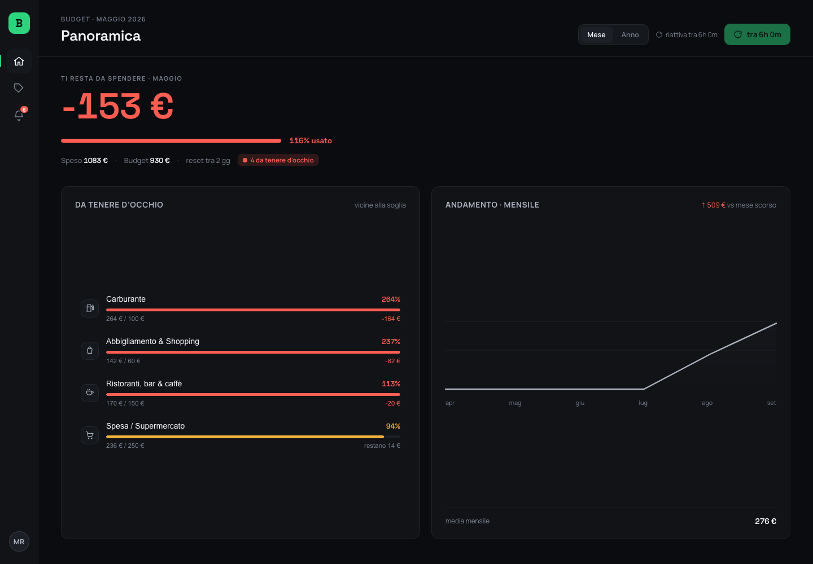
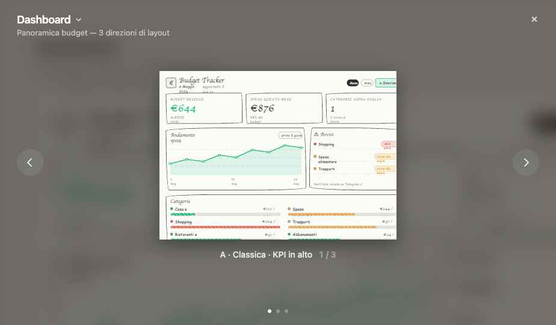

# Budget Tracker

> **English summary.** Personal app that imports my bank transactions via Open Banking (PSD2, Enable Banking), categorises them with rules that learn from my corrections, compares spending with monthly thresholds per category and notifies me when a category nears or exceeds its limit. I defined requirements, data model, interface and priorities; the code was written with coding agents. Single user, running on my real account. Node.js, TypeScript, PostgreSQL, React prototype. 8 automated tests on the core pipeline.

App personale che importa i movimenti del conto via Open Banking (PSD2), li categorizza, li confronta con soglie mensili per categoria e manda una notifica quando una categoria si avvicina al limite o lo supera.



*Dati di esempio: il repository non contiene dati bancari reali.*

## In breve

| | |
|---|---|
| **Ruolo** | Product owner, designer e developer: requisiti e criteri di accettazione, modello dati e interfaccia, priorità degli incrementi, sviluppo tramite coding agent, test e accettazione |
| **Periodo** | maggio – luglio 2026 (primo import reale il 31 maggio, in uso da luglio) |
| **Stack** | Node.js e TypeScript, Express, PostgreSQL, React (prototipo senza build), `node:test` |
| **Integrazioni** | Enable Banking (Open Banking PSD2), API di Notion, notifiche macOS; Telegram implementato ma non usato |
| **Stato** | funzionante con un conto reale; progetto personale a utente singolo |

## L'obiettivo

Dal [documento di progetto](docs/documento-di-progetto-2026-05-31.pdf): importare in automatico le transazioni del conto, categorizzarle, confrontare la spesa con una soglia mensile per categoria e avvisare quando una categoria si avvicina al limite o lo supera.

Quattro requisiti non funzionali hanno guidato le scelte:

- nessuna transazione duplicata o persa;
- costo zero o minimo;
- dati bancari trattati solo in locale o su un servizio controllato dall'utente (formulazione del documento di progetto);
- regole di categorizzazione e soglie facili da modificare.

## Decisioni di prodotto

1. **Privacy prima della comodità.** Il documento di progetto prevedeva Supabase; in implementazione ho scelto di tenere tutto in locale: il server risponde solo su `127.0.0.1`, il database è un Postgres locale e le notifiche sono quelle native di macOS. L'unica copia esterna, opt-in, è la sincronizzazione con Notion (descrizione, importo, data ed esercente delle uscite): un compromesso consapevole per poter correggere le categorie dal telefono. Il supporto a un database gestito (`DATABASE_URL`) è predisposto ma non testato.
2. **Dall'aggregatore previsto a quello che funziona.** Il documento di progetto prevedeva Tink e scartava GoCardless, il cui piano gratuito era difficile da attivare. In implementazione il collegamento reale è passato a Enable Banking; l'integrazione Tink è rimasta uno stub.
3. **Categorie che imparano** (regole per esercente, non machine learning). Enable Banking non fornisce categorie di spesa. La categorizzazione combina regole sul nome dell'esercente con le correzioni dell'utente: quando riassegno una transazione, l'app memorizza la regola e la applica a tutte le transazioni passate e future dello stesso esercente.
4. **Rispettare i limiti della banca.** Le API PSD2 consentono poche sincronizzazioni al giorno. Oggi convivono tre intervalli non ancora unificati: la sincronizzazione all'avvio parte solo se l'ultima ha più di 4 ore, lo scheduler gira ogni 5 ore e il pulsante manuale si riattiva dopo 6 ore; l'interfaccia mostra quando sarà possibile la prossima.
5. **Notion come punto di correzione.** La sincronizzazione con Notion è bidirezionale, con una regola di proprietà per campo: l'app possiede importi, date e movimenti; Notion possiede categorie, budget e annotazioni manuali. Due fonti non scrivono mai sullo stesso campo, quindi non nascono conflitti.

## Dal wireframe all'interfaccia

L'interfaccia è passata da tre direzioni di layout in wireframe a una prima versione ad alta fedeltà, fino al redesign attuale (in alto).



## Architettura

La pipeline esegue in sequenza: import → deduplica → categorizzazione → aggregazione e soglie → notifiche.

Si regge su due interfacce principali, più una per le notifiche (`Notifier`):

- **`TransactionSource`**, da dove arrivano i movimenti: dati finti, CSV o Enable Banking;
- **`Store`**, dove vengono salvati: in memoria o su Postgres.

Si cambia sorgente o database da variabile d'ambiente, senza toccare la pipeline. Il flusso funzionale iniziale, disegnato prima dello sviluppo, è in [`docs/flusso-funzionale.png`](docs/flusso-funzionale.png): non comprende import e deduplica, e il promemoria sotto soglia che prevede non è stato implementato.

## Provarlo in locale

Senza configurazione, con dati finti e senza database:

```bash
cd app
npm install
npm run run:demo   # pipeline completa, stampa la dashboard nel terminale
npm run dev        # dashboard web su http://localhost:3000
npm test           # 8 test sulla pipeline (in memoria)
```

## Limiti

- Utente singolo, provato con una sola banca (Hype).
- L'interfaccia è un prototipo React caricato senza build; alcune etichette di periodo sono ancora statiche.
- Le cancellazioni fatte in Notion non si propagano all'app.
- Gli 8 test coprono la pipeline in memoria: non ci sono test su Postgres, Enable Banking, Notion e server.
- Deduplica: la banca non fornisce sempre un identificativo di transazione; in quel caso l'app ne costruisce uno da data, importo ed esercente, quindi due acquisti identici nello stesso giorno presso lo stesso esercente verrebbero contati una volta sola. Oltre i 90 giorni senza sincronizzazione la banca non restituisce più i movimenti. Il requisito «nessuna transazione persa» è quindi coperto solo in parte.
- La pagina Notifiche mostra ancora alcuni eventi dimostrativi.
- Nessun deploy pubblico, per scelta: i dati bancari restano sulla macchina.

## Documenti

- [Documento di progetto](docs/documento-di-progetto-2026-05-31.pdf): analisi funzionale, architettura dell'informazione e architettura software, scritto il 31 maggio 2026 prima del codice. È la versione iniziale, basata su Tink e Supabase.
- Questo repository è un export pulito, senza dati personali: lo sviluppo è avvenuto in un repository privato.
- [Dettagli tecnici](app/README.md) · [Runbook](app/RUNBOOK.md) · [Istruzioni per i coding agent](app/CLAUDE.md)
